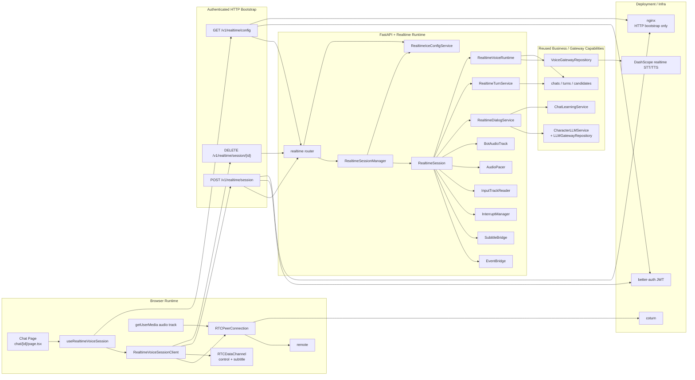
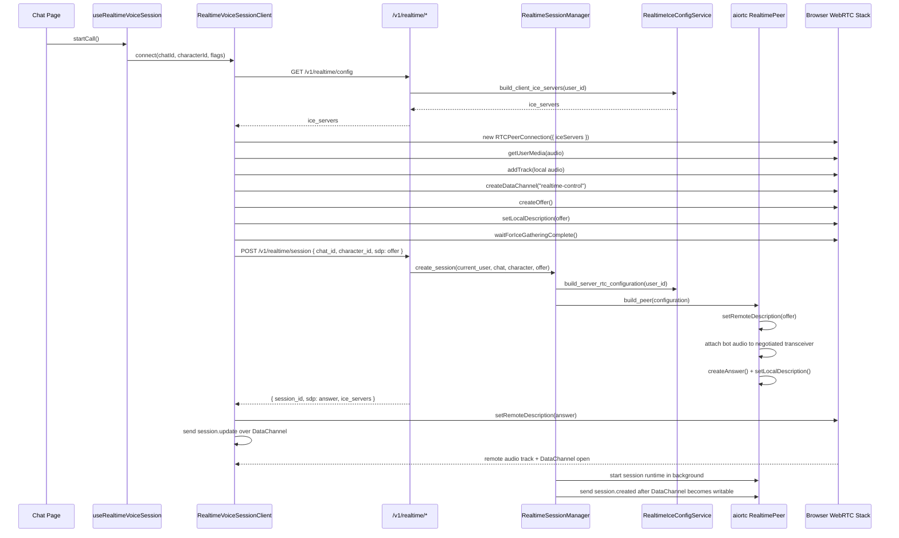
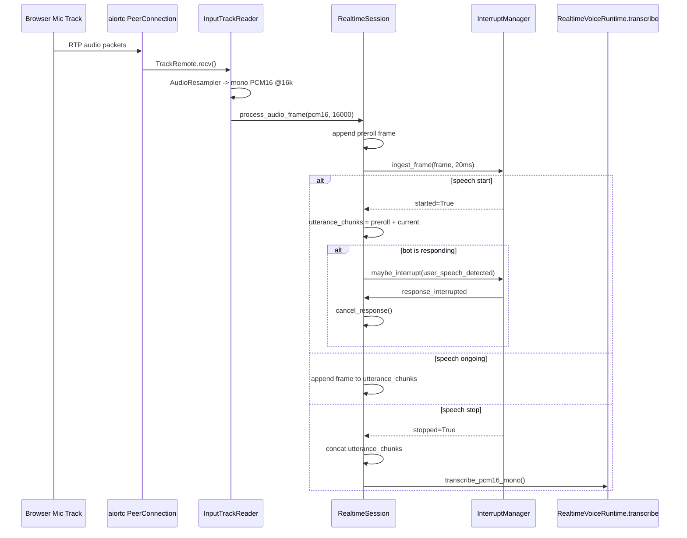
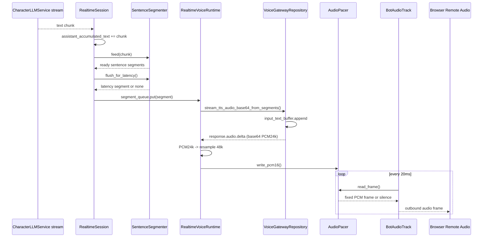
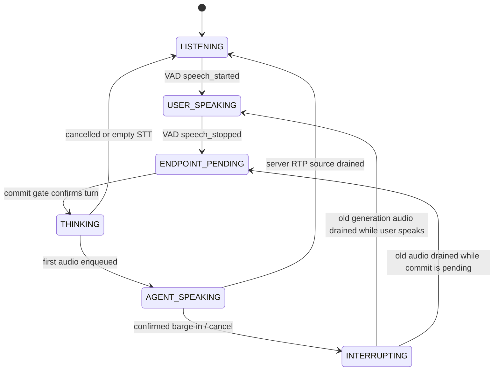
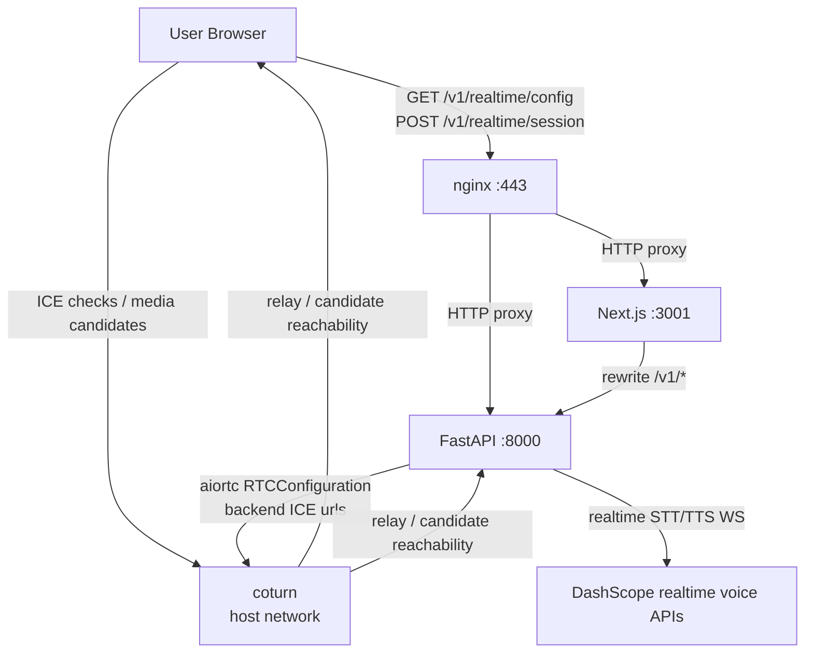

# ParlaSoul 实时通话架构文档

更新时间：2026-07-17

## 1. 文档定位

### 1.1 目标读者

这份文档面向已经做过下列任一系统的工程师：

- WebRTC / SFU / P2P 实时音频
- 语音助手 / 实时 STT / 流式 TTS
- 会话型 LLM runtime
- 会话状态机与全双工打断

它不是“WebRTC 入门”或“逐文件解释”。它的目标是回答两个问题：

1. ParlaSoul 的实时通话到底是不是一个独立系统，还是对现有聊天栈的运行时拼装。
2. 这条链路在浏览器、后端、语音网关、部署基础设施之间的职责边界和失败语义是什么。

### 1.2 文档范围

只覆盖当前生产主链路中的实时通话能力：

- 前端聊天页中的实时通话入口
- `/v1/realtime/config`、`/v1/realtime/session*` 与 `/v1/realtime/telemetry/*`
- 浏览器 WebRTC 会话与 DataChannel 控制面
- 后端 `src/realtime/*` 运行时
- 复用到的聊天树、LLM、翻译、TTS 网关
- ICE / TURN / Docker / nginx 部署闭环
- 不保存音频与转写正文的质量观测、测试场景和诊断页

明确不覆盖：

- 普通聊天页的 SSE 文本流
- 单条消息手动点喇叭播放
- 音色克隆与音色管理 UI
- Better Auth 的完整认证实现细节

### 1.3 一句话结论

ParlaSoul 的实时通话不是一套与主业务完全平行的新系统，而是一个**会话级实时 runtime**：

- transport 层使用 WebRTC
- control 层使用窄化的 DataChannel 事件协议
- semantic 层复用现有聊天树、角色 LLM 路由、学习翻译和语音网关
- observability 层保存内容无关的阶段耗时、状态事件和 WebRTC 统计
- deployment 层依赖 TURN 作为一等基础设施，而不是把 nginx 误当成媒体通道

---

## 2. 先给结论：架构不变量

在读任何实现细节之前，先固定这几个不变量。

### 2.1 Realtime 不是第二套聊天业务域，它是运行时宿主与独立观测域

实时通话没有新建第二套“聊天消息模型”或“角色回复服务”。正式会话内容仍复用现有业务表：

- `chats`
- `turns`
- `candidates`

Realtime 运行时新增了：

- WebRTC 会话宿主
- 实时音频 ingress/egress
- DataChannel 控制协议
- 会话级打断与字幕桥

为了让真实测试可以复盘和继续优化，系统另外新增四张**内容无关的观测表**：

- `realtime_call_sessions`
- `realtime_call_events`
- `realtime_turn_metrics`
- `realtime_webrtc_stats_samples`

这些表不属于聊天内容真相源，不保存原始音频、完整或部分转写、字幕正文、LLM/TTS 文本、SDP、IP、URL、设备 ID/标签或原始 User-Agent。正常聊天产生的 user/assistant turn 仍按产品原有语义进入 `turns` 和 `candidates`；观测表只保存数值、时间偏移、受控枚举和计数。

所以 realtime 的正确心智模型不是“另一个聊天系统”，而是：

> 现有聊天树和 LLM/TTS/STT 能力，被装配进一个低时延会话运行时。

### 2.2 浏览器与后端之间有三个职责平面

浏览器和后端不是只靠一条 WebRTC 连接做所有事，而是分成三个职责平面：

- bootstrap plane
  - 认证后的 HTTPS 请求
  - 获取 ICE 配置
  - 提交 SDP offer
  - 删除 session
- session plane
  - WebRTC 媒体轨道
  - WebRTC DataChannel 事件
- observability plane
  - 认证后的 HTTPS 批量事件与 `getStats()` 样本
  - 每次通话的 `observation_id`
  - `/realtime-lab` 对已保留测试数据的只读诊断

也就是说，`/v1/realtime/session` 只是建连入口，不承载会话过程中的持续业务流；遥测批次也不替代 DataChannel，更不承载媒体或对话正文。

### 2.3 DataChannel 只承载控制与字幕，不承载音频

实时通话里：

- 音频上行：浏览器麦克风 track
- 音频下行：服务器 bot audio track
- 控制与字幕：DataChannel JSON 事件

这和普通聊天 SSE 不同：

- 普通聊天里音频增量是 `tts_audio_delta`
- realtime 通话里 bot 语音不走 JSON base64，而是走 WebRTC 音频轨

### 2.4 后端内部统一处理格式是 PCM，而不是传输格式

当前实现里，浏览器与 aiortc 这条 WebRTC 音频轨协商出来的传输编解码就是 Opus。

但后端 realtime 运行时内部处理统一收敛为 PCM16：

- 入站 audio track 解到 PCM16 mono
- VAD / STT 输入使用 PCM
- TTS 返回 PCM
- `AudioPacer` 维护 PCM 帧
- `BotAudioTrack` 再交给 WebRTC sender

因此系统明确区分：

- transport codec
- runtime audio representation

### 2.5 TURN 是部署面的一部分，不是可选装饰

本地开发能通，不代表服务器能通。

生产里如果没有：

- 公网可达的 STUN/TURN
- 正确的 ICE server 配置
- 宿主机级 UDP 端口开放
- coturn 外网/内网地址映射

那么 `/v1/realtime/session` 成功只表示**信令成功**，不表示**媒体可达**。

---

## 3. 总体分层

这张图只回答一个问题：

> 实时通话这条能力，从前端到后端到底由哪些运行平面组成。



这张图里最重要的边界是：

- `Bootstrap` 和 `Browser Runtime` 不是一个东西
- `RealtimeSession` 是宿主，不是 provider
- `RealtimeDialogService / RealtimeTurnService / RealtimeVoiceRuntime` 都只是 runtime 里复用现有业务能力的适配层

---

## 4. 会话建立：不是一条请求，而是两阶段握手

这张图只回答一个问题：

> 浏览器从点击“实时通话”到进入稳定会话，实际发生了什么。



### 4.1 前端建立顺序为什么必须是这样

前端关键逻辑在：

- `useRealtimeVoiceSession`
- `RealtimeVoiceSessionClient.connect()`

其建立顺序不是随便写的，而是受 WebRTC 约束：

1. 先取 `GET /v1/realtime/config`
2. 再 `new RTCPeerConnection({ iceServers })`
3. 再 `createOffer / setLocalDescription / ICE gathering`
4. 再把 offer 发给后端

原因是：

- `iceServers` 必须在 `RTCPeerConnection` 初始化时生效
- 如果先 `createOffer()` 再拿 TURN 配置，浏览器本地 candidate gathering 已经错过时机

这也是这套实现从“只依赖默认 host candidate 的本地优先形态”收敛到“显式依赖 ICE/TURN 的部署可用形态”的核心改动点。

### 4.2 为什么 `POST /session` 仍然回 `ice_servers`

当前 `POST /v1/realtime/session` 仍然把 `ice_servers` 带回响应。

这在浏览器侧已经不是必须，因为真正关键的是前置的 `GET /config`。

当前保留它的价值主要是：

- `GET /v1/realtime/config` 与 `POST /v1/realtime/session` 的返回结构保持一致
- 会话创建响应里直接包含本次协商使用的 ICE 信息快照

### 4.3 为什么 nginx 只是 bootstrap，不是媒体面

线上部署里：

- `/v1/*` 和 `/health` 由 nginx 反代到 backend
- 页面由 nginx 反代到 frontend

但媒体流不走 nginx。

nginx 的职责只是：

- 托管 HTTPS 入口
- 转发 bootstrap HTTP 请求

真正音频媒体路径由：

- ICE candidate 选择
- TURN relay
- WebRTC transport

决定。

---

## 5. 前端运行时：会话 UI 只是薄层，真正状态都在 hook 和 client

### 5.1 入口位置

实时通话入口挂在聊天页输入区：

- `ChatInput` 负责入口按钮、挂断按钮、收音开关和 speaking 态视觉
- `chat/[id]/page.tsx` 负责把 realtime hook 接到聊天线程、错误对话框和消息刷新
- 隐藏 `<audio>` 元素由页面层持有，只承担远端音频播放

也就是说：

- 当前没有独立的 realtime 弹窗或独立页面承载会话
- `page.tsx` 不是 WebRTC runtime owner
- 真正 owner 仍然是 `useRealtimeVoiceSession`

### 5.2 `useRealtimeVoiceSession` 的职责

这个 hook 做的是**React 状态投影**：

- 持有唯一 `RealtimeVoiceSessionClient`
- 绑定/解绑远端 `<audio>`
- 暴露 `isConnecting / isConnected`
- 把 DataChannel 字幕事件投影成 React state
- 统一 `startCall / endCall`

它没有自行做 WebRTC 协商，也不解析 SDP。它的角色是：

> 把 imperative 的浏览器会话对象投影成页面状态。

### 5.3 `RealtimeVoiceSessionClient` 才是浏览器 runtime 核心

这个类承担了浏览器侧全部非 UI 实时职责：

- 请求 ICE 配置
- 获取麦克风
- 创建 `RTCPeerConnection`
- 创建 DataChannel
- 添加本地音频 track
- 生成 offer
- 等待本地 ICE gathering 完成
- 调用 `/v1/realtime/session`
- 设置远端 answer
- 解析 DataChannel 事件
- 把远端 audio track 绑定到 `<audio>`

这是一个典型的：

> non-React session runtime object

React 只是在外面包了一层 hook。

### 5.4 前端不会复用普通聊天页的 STT/TTS 逻辑

这点非常关键。

实时通话和普通聊天虽然都涉及语音，但浏览器侧实现不是同一条链路：

- 普通聊天输入麦克风：
  - `SttRecorder`
  - 浏览器录音 -> HTTP 上传 -> 后端 STT
- 实时通话：
  - `getUserMedia`
  - WebRTC audio track 持续上行

普通聊天语音播放：

- `TtsPlaybackManager`
- 解码增量音频或整段音频并播放

实时通话：

- 浏览器直接播放远端 WebRTC audio track

这意味着 realtime 通话不是“把普通聊天 TTS/STT 持续化”，而是完全不同的 transport/runtime 模式。

---

## 6. 后端宿主：`RealtimeSessionManager` + `RealtimeSession`

### 6.1 `RealtimeSessionManager` 是进程内 session registry

`RealtimeSessionManager` 做三件事：

1. 进程启动与关闭时管理 session 生命周期
2. 认证通过后创建 session
3. 通过字典持有活跃 session，并按 `session_id` 关闭

它不做：

- 逐帧音频处理
- STT / TTS / LLM 推理
- turn 落库

所以它不是业务服务，而是：

> process-local session host / registry

### 6.2 `RealtimeSession` 才是真正的会话运行时

每个实时通话 session 独享一套对象：

- `RealtimePeer`
- `RealtimeEventBus`
- `AudioPacer`
- `EventBridge`
- `SubtitleBridge`
- `InterruptManager`
- `RealtimeDialogService`
- `RealtimeTurnService`
- `RealtimeVoiceRuntime`
- 可选的会话级 `RealtimeTelemetryRecorder`

同时持有会话级状态：

- `session_id`
- `user_id / chat_id / character_id`
- `SessionConfig`
- 当前状态机状态
- 当前 `_response_task`
- 当前 turn 上下文 `_current_turn_ctx`
- 单调递增的 `generation_id` 与该 generation 的任务集合

这说明 ParlaSoul 的 realtime 模型不是多租户共享 runtime，而是：

> 每个会话一套轻量对象图，进程内隔离。

### 6.3 生命周期与所有权链

所有权链如下：

1. `FastAPI lifespan`
2. `app.state.realtime_session_manager`
3. `RealtimeSessionManager._sessions[session_id]`
4. `RealtimeSession`
5. `RealtimePeer / InputTrackReader / EventBridge / response_task / tts_task`
6. 会话级 `RealtimeTelemetryRecorder` 后台有界写队列

关闭顺序也沿这条链回收：

- cancel `response_task`
- stop `InputTrackReader`
- stop `EventBridge`
- close `AudioPacer`
- close `RealtimePeer`
- flush 并 close `RealtimeTelemetryRecorder`

这条链的好处是：

- session 级资源不会泄漏到全局
- transport、runtime、business 资源在一个边界内销毁

---

## 7. 控制面：DataChannel 上跑的是一个窄协议，不是通用总线

### 7.1 客户端发给服务端的事件

客户端当前支持这些窄控制事件：

- `session.update`
  - 更新 `translation_enabled`
- `session.ping`
  - 占位/保活事件
- `response.cancel`
  - 用户主动取消当前 assistant response
- `input_audio_buffer.mute`
  - 麦克风静音；如存在待提交用户语音，会强制提交当前 turn
- `input_audio_buffer.unmute`
  - 麦克风恢复；后端重新启动输入 track reader

这不是一个开放式协议，而是**非常窄的控制面**。

### 7.2 服务端发给客户端的事件

当前服务端发出的事件集合也很克制：

- `session.created`
- `input_audio_buffer.speech_started`
- `input_audio_buffer.speech_stopped`
- `response.started`
- `response.interrupted`
- `response.audio_stopped`
- `response.done`
- `conversation.turn.created`
- `conversation.turn.updated`
- `conversation.turn.failed`
- `subtitle.delta`
- `subtitle.final`
- `error`
- `session.updated`

注意两点：

1. 这些名字是当前前后端自定义会话协议中的固定事件名，并且只覆盖这里列出的这组事件。
2. 事件集只覆盖**会话状态感知**，不承载媒体本身。

`response.interrupted` 表示打断已经被确认，`response.audio_stopped` 表示旧 generation 在服务端 RTP source 侧的 fade tail 已消费完；两者都不等同于操作系统扬声器已经静音。浏览器会另外用远端 Web Audio 能量做首个非静音音频和停止点估计，并只保存数值结果。

### 7.3 `EventBridge` 的真正角色

`EventBridge` 不是“随便转发事件”。

它做的是：

- 从 `RealtimeEventBus` 订阅固定事件集
- 把内部 event type 投影到浏览器可见协议
- 通过单一 `send_json` 出口把控制面串行化到 DataChannel

也就是说它是：

> internal event model -> browser session protocol

而不是：

> general-purpose event bus adapter

### 7.4 `RealtimeEventBus` 的语义是 best-effort

`RealtimeEventBus` 有两个值得写进架构文档的性质：

- subscriber queue `maxsize=200`
- `publish()` 时如果 `QueueFull`，直接丢弃

所以它不是可靠事件系统，而是：

> in-process best-effort coordination bus

这很重要，因为这意味着：

- 它适合字幕、状态、控制信号
- 它不适合需要严格不丢的审计语义

---

## 8. 入站媒体：`TrackRemote` -> PCM16 -> preroll + VAD -> utterance

这张图只回答一个问题：

> 用户说一句话时，后端到底如何从音频帧里识别出一轮 utterance。



### 8.1 `InputTrackReader` 的职责非常单纯

它只负责：

- `track.recv()`
- 使用 `av.AudioResampler` 转成 `mono + 16k`
- 把 PCM16 bytes 回调给 `RealtimeSession`

它不做：

- VAD
- 中断
- STT
- 字幕

所以它只是 transport/media 适配层。

### 8.2 preroll 说明系统不是“从 speech_started 之后才开始录”

`RealtimeSession` 维护：

- `_preroll_frames: deque(maxlen=15)`

每帧按 20ms 算，最多保留约 300ms 预滚动音频。

当 `speech_started` 触发时：

- 当前 utterance 不只从“检测到开始”的那一刻起算
- 而是把前面的 preroll 一并拼进去

这是因为任何实时 VAD 都存在检测滞后。

### 8.3 当前 VAD 是 Silero 模型流 + 会话级边界整形

`InterruptManager.ingest_frame()` 当前用的是：

- `SileroVADStream`
- 16k PCM window
- `REALTIME_VAD_THRESHOLD`
- `REALTIME_VAD_END_THRESHOLD_DELTA`
- `REALTIME_VAD_MIN_SILENCE_MS`
- `REALTIME_VAD_SPEECH_PAD_MS`
- `REALTIME_VAD_PRE_ROLL_MS`

也就是说当前实现是：

> 模型 speech probability + start/end hysteresis + speech pad + preroll

这样做的效果是：

- 比纯能量门限更抗噪声
- speech start 时可以把模型检测滞后的前置语音补回来
- speech stopped 仍然只是 VAD 事件，不直接等同于用户语义回合结束

### 8.4 用户打断 bot 是在音频 ingress 这一层决定的

如果 `speech_started` 发生时 session 正处于 `AGENT_SPEAKING`：

- `RealtimeSession._begin_soft_interrupt("user_speech_detected")`
- `AudioPacer.pause()`
- 等待 `REALTIME_INTERRUPT_HARD_CONFIRM_MS`
- 如果用户持续说话，再 `InterruptManager.maybe_interrupt()` 并取消 response
- 如果只是短噪音或很快停止，则恢复 `AudioPacer.resume()`

所以全双工打断不是在 LLM 返回层做的，而是在：

> user audio ingress -> soft pause -> hard confirmation / resume

这个位置决定的。

---

## 9. 语义面：STT、输入变换、聊天树、LLM、翻译

### 9.1 STT 由 `RealtimeVoiceRuntime` 代理，但底层仍走 `VoiceGatewayRepository`

`RealtimeVoiceRuntime.transcribe_pcm16_mono()` 最终调用：

- `VoiceGatewayRepository.transcribe_audio()`

这意味着 realtime 没有单独实现第二套 STT provider 接口。

STT provider 选择仍然受现有语音网关能力约束：

- Qwen3 realtime ASR
- 或旧的 FunASR 路径

### 9.2 STT 结果直接进入 realtime 对话语义层

STT 成功后，`RealtimeSession` 会把识别出的 `raw_user_text` 直接送入：

- `RealtimeTurnService.begin_turn()`
- `RealtimeDialogService.stream_assistant_reply()`

当前 realtime 不再对用户输入做“中英混输转英文”的额外变换。

### 9.3 Realtime 复用了聊天树，但只复用了必要最小面

`RealtimeTurnService.begin_turn()` 会：

1. 锁定 chat
2. 校验 chat/character/user 关系
3. 在当前活动叶子下新增 user turn
4. 为 user turn 创建 final candidate
5. 创建 assistant placeholder turn
6. 创建 assistant placeholder candidate
7. 更新 `chat.last_turn_*` 和 `active_leaf_turn_id`

所以 realtime 的持久化策略不是“结束后再补写”，而是：

> 先写 placeholder，再让 runtime 逐步填充

这和普通聊天 SSE 主链路保持一致的业务哲学。

### 9.4 Realtime 复用了 LLM system prompt builder，但刻意关闭 memory

`RealtimeDialogService.stream_assistant_reply()` 会调用：

- `_load_llm_history_messages_from_leaf()`
- `_build_llm_system_prompt()`

但传入的是：

- `memories={"episodic": [], "semantic": []}`
- `use_all_semantic=False`
- `preferred_expressions=None`
- `memory_active=False`

这说明 realtime 复用了 prompt 组装器，但没有开启完整 memory / preferred expressions 语义。

当前 realtime 的语义上下文来源是：

- 角色系统提示词
- 当前 chat branch 历史
- 本轮用户输入

而不是完整的长时记忆增强。

### 9.5 LLM stream 本身没有 realtime 特供 provider

回复流仍然由：

- `CharacterLLMService.resolve_runtime_route()`
- `CharacterLLMService.chat_stream_messages()`

驱动。

也就是说 realtime 在 LLM 这一层没有单独 provider/runtime，它只是在：

> session runtime 中消费普通角色回复流

### 9.6 assistant 中文字幕是后处理，不是与英文主回复并行生成

当前实现是：

1. 先流式输出 `assistant_raw`
2. 等主回复结束
3. 如果开启翻译，再调用 `translate_assistant_chunk()`
4. 只在最终以 `assistant_translated` 发给客户端

所以 assistant 中文字幕当前是：

> final-only semantic projection

而不是：

> token-level bilingual streaming

---

## 10. 出站语音：LLM chunk -> SentenceSegmenter -> DashScope TTS -> AudioPacer

这张图只回答一个问题：

> bot 的语音为什么能在回复还没结束时就开始播。



### 10.1 `SentenceSegmenter` 的角色不是 NLP，而是低延迟 chunk boundary 决策

当前 realtime TTS 切段不是简单按标点直接切，也不是等全文结束。

`SentenceSegmenter` 同时做三件事：

- 正常句尾切段
- 缩写/数字/URL 等特例保护
- 在长时间没有句尾时做低延迟 flush

这使得 TTS 可以在：

- 语义相对自然
- 首包不必等整句完全结束

之间折中。

### 10.2 `RealtimeVoiceRuntime` 仍然只是 runtime adapter

它做的事只有：

- STT 调用代理
- 角色音色查找
- 把分句结果喂给 `VoiceGatewayRepository`
- 把 TTS PCM 按 mime type 中的采样率重采样到 48k
- 写入 `AudioPacer`

它自己不掌握：

- session 状态
- 打断决策
- DataChannel 协议

### 10.3 `VoiceGatewayRepository.stream_tts_audio_base64_from_segments()` 是真正的流式 TTS 出口

这个方法的关键点是：

- 建立 DashScope realtime TTS WebSocket
- `session.update`
- 持续发送 `input_text_buffer.append`
- 收到 `response.audio.delta` 就立刻 `yield`
- 最后 `session.finish`

所以 realtime bot 语音不是整段 TTS，而是：

> segment-streamed upstream TTS

### 10.4 `AudioPacer` 是把任意上游 chunk 变成固定帧的时钟整形器

`AudioPacer` 维护：

- sample rate = 48k
- mono
- frame = 20ms
- interrupt fadeout = 50ms
- 当前 `generation_id` 与旧 generation 写入隔离
- first enqueue / first RTP-source read / drained 信号
- 当前与峰值缓冲、underrun、padding、fadeout 等计数

它解决的问题是：

- 上游 TTS chunk 大小任意
- WebRTC sender 需要稳定节奏的帧

所以它是：

> chunked PCM -> clocked frame stream

### 10.5 打断时为什么不会爆出一大段旧音频

关键不在取消 LLM，而在：

- `AudioPacer.clear_with_fadeout()`

这意味着：

- 未发出的旧 PCM 会被清空
- 但不是硬切，先用极短 fadeout 收尾
- 已取消 generation 的 TTS writer 即使稍后返回数据，也会被 pacer 拒绝

所以用户听到的是：

- 很快停止
- 不是点击式爆音

### 10.6 出站音频缓冲不允许丢中间帧

`AudioPacer` 有一个上限缓冲：

- `REALTIME_AUDIO_PACER_MAX_BUFFER_MS`
- 默认 `2000`

这个上限只用于限制内存和延迟积压，不表示可以裁掉旧音频。TTS websocket 可能在短时间内返回大量 PCM delta，而 `BotAudioTrack` 仍然按 20ms WebRTC 时钟消费。如果缓冲满了，正确语义是：

> TTS 写入等待播放端释放空间，而不是丢弃缓冲区头部去保留最新尾部。

原因是语音是时间序列。保留尾部、丢弃中间待播放 PCM 会造成用户听到“开头正常、结尾正常、中间跳变”的现象。当前 `AudioPacer.write_pcm16()` 对写入方施加 backpressure，保证 `BotAudioTrack.read_frame()` 仍按顺序读出完整帧。

排查时可以用日志快速看是否存在音频裁剪或严重积压：

- `target_audio_ms`
  - TTS 实际生成的音频总时长
- `frames_read * 20ms`
  - WebRTC 输出轨实际读出的音频时长
- `pacer_underrun_count`
  - 播放过程中缓冲不足次数
- `pacer_buffered_ms`
  - TTS 结束时仍在 pacer 中等待播放的缓冲

正常情况下，完整播放结束后 `frames_read * 20ms` 应接近 `target_audio_ms`，只允许有 frame 对齐、起始 prebuffer 和尾帧 padding 带来的小幅偏差。`response.done` 只有在当前 generation 的 TTS 输入关闭且 pacer 被 `BotAudioTrack` 实际读空后才发送；它不再表示“仅完成入队”。

### 10.7 隐私安全的持久化诊断取代音频文件捕获

方案 A 明确禁止保存原始音频和完整转写，因此旧的 WAV / PCM / TTS 文本诊断捕获已被代码级禁用。兼容对象即使仍被旧调用点引用，也不会创建目录、音频文件或正文时间线。

当前诊断只保存：

- 阶段时间偏移和耗时
- 状态转移与固定 reason/error code
- generation、帧数、字符数等计数
- pacer 当前/峰值缓冲、underrun、fadeout 与 stale-write rejection
- 浏览器归一化后的 WebRTC stats

所有写入口都经过严格 schema、隐私关键词拒绝以及固定事件名/原因码/错误码白名单。“符合 slug 格式”不是放行条件，白名单外的代码会在写入前被拒绝。以下内容不能进入遥测 JSON 或类型化列：

- PCM、WAV、base64 音频或任意音频 payload
- partial/final transcript、字幕正文、prompt、LLM/TTS 文本
- SDP、candidate 地址、IP、URL
- 麦克风/扬声器设备 ID、label
- 原始 User-Agent 或任意异常 message

诊断时按 `observation_id` 查看事件、turn 指标和 1 Hz WebRTC 样本，不再依赖事后收集音频文件。

---

## 11. 持久化语义：realtime 如何与聊天树共存

### 11.1 Realtime 不是旁路写日志，而是正式进入聊天树

每次 utterance 都会进入正式聊天树：

- user turn
- user candidate
- assistant placeholder turn
- assistant placeholder candidate

这意味着通话结束后刷新聊天页，历史是连续的。

### 11.2 success / interrupted / error 三种完成语义不同

`RealtimeTurnService` 的 finalize 逻辑非常重要：

- success
  - `cand.content = accumulated_text`
  - `cand.is_final = True`
  - chat leaf 指针指向 assistant turn
- interrupted
  - 只有在 `assistant_accumulated_text` 非空且 `llm_completed=True` 时，才保留内容并标记 OK
  - 否则把内容置空并标记 turn `ERROR`
- error
  - 保存当前 accumulated 文本或 `Error: ...`
  - candidate 非 final
  - turn `ERROR`

也就是说，realtime 对中断并不是简单“保留已说内容”。

它区分：

- 逻辑完成后的中断
- 未完成回复的中断

这是为了避免把半截、语义未闭合的结果误当成正式 assistant reply。

### 11.3 Realtime 共享了 turn tree 的分支语义，但没有新增 realtime 专属 branch model

当前 realtime 直接使用现有 `chat.active_leaf_turn_id`。

所以通话中的每轮回复都在原有活动分支上继续生长，而不是另建“语音模式分支”。

这简化了：

- 历史统一展示
- sidebar 最近会话更新
- turn snapshot 复用

但也意味着：

- realtime 与文本聊天共享同一 branch 所有权
- 中断和刷新后看到的历史，是同一业务树的不同 continuation

### 11.4 观测记录与聊天内容是两条不同持久化路径

浏览器在申请麦克风前先创建 observation，并在 WebRTC bootstrap 请求中携带 `observation_id`。后端同步校验 observation 的 user/chat/character 所有权并绑定唯一 `rt_*` session；同一个 observation 不能被第二个 runtime 会话复用。

观测 API 为：

- `POST /v1/realtime/telemetry/sessions`
- `POST /v1/realtime/telemetry/sessions/{observation_id}/events/batch`
- `POST /v1/realtime/telemetry/sessions/{observation_id}/webrtc-stats/batch`
- `PATCH /v1/realtime/telemetry/sessions/{observation_id}`
- `GET /v1/realtime/telemetry/sessions`
- `GET /v1/realtime/telemetry/sessions/{observation_id}`

客户端事件与 stats 使用单调递增 seq 做幂等；服务端 recorder 每个会话独享一个容量 1000 的后台队列，媒体路径只做校验和 enqueue，数据库 I/O 不进入 20ms 音频回调。普通时间线事件是 best-effort，持久化失败最多尝试 3 次后计入 dropped；runtime 绑定、turn 指标和 session/finalize 是关键操作，会持续指数退避重试，直到成功或会话关闭时 5 秒 flush deadline 到期。四张表均启用并强制 PostgreSQL RLS，普通请求只能读取自己的 observation。

会话终态采用 first-wins：最先成功写入的 `completed/failed/cancelled` 保持不变，客户端和服务端晚到的不同终态只会得到当前记录，不会覆盖首个终态，也不会造成无限重试。`duration_ms`、`turn_count`、`interruption_count` 继续按最大值合并；首个 failure stage/error code 不被晚到写入替换。

客户端和服务端分别使用自己的 monotonic clock。`occurred_offset_ms` 只在同一 `source` 内可直接相减；跨 source 的同屏时间线按接收时间做近似对齐，不能把两个 offset 当成同一个绝对时钟。

关键指标语义：

- `server_first_audio_read_latency_ms`：aiortc 从服务端 RTP source 拉到第一帧，不是浏览器已播放。
- `client_first_audio_played_latency_ms`：浏览器在远端 MediaStream 中检测到首个非静音能量的 playout 估计；需与 `media_element.playing` 分开看，无法证明操作系统扬声器硬件实际出声。
- `tts_ttfb_ms`：服务端同一 monotonic 时钟域内 `tts_request_start -> tts_first_audio`；只衡量语音网关首包，不混入 sentence aggregation。
- `ttfa_ms`：客户端收到服务端 `input_audio_buffer.speech_stopped` 到检测到首个非静音远端音频，包含该事件之后的 STT/LLM/聚合/TTS、WebRTC 下行和浏览器 playout；服务端 endpointing 另由 `endpointing_latency_ms` 记录。
- `barge_in_stop_latency_ms`：用户开始说话到旧回复首次进入持续静音的时间，只在服务端确认打断后落库；短 backchannel 的软暂停不会计为成功打断。
- `playout_queue_peak_ms/final_ms`：当前 generation 的服务端 pacer 峰值与排空时深度；session summary 取各 turn 的峰值最大值，用来判断是否长期超过 400ms。
- `jitter_buffer_delay_ms`：相邻 stats 样本的 `jitterBufferDelay` 增量除以 `jitterBufferEmittedCount` 增量。

第一阶段工程目标用于本项目回归，不声明为行业标准：

- TTFA：P50 < 1 秒，P95 < 1.8 秒
- 确认打断后的旧音频停止：P50 < 200ms，P95 < 350ms
- 普通网络下 playout queue 不长期超过 400ms
- 旧 generation 的音频、字幕和 turn 写入为 0
- jitter buffer 平均延迟 > 120ms、丢包率 > 3% 或 concealed ratio > 2% 时标记质量告警

测试数据不配置自动 TTL；用户完成测试后仍可在 `/realtime-lab` 按 observation 查看。这里的“保留”只针对内容无关遥测，绝不放宽音频和转写正文禁入规则。

---

## 12. 会话状态机与并发模型

### 12.1 状态机是粗粒度运行时状态，而不是完整协议状态

当前状态机使用明确的 turn-taking 词汇：

- `LISTENING`
- `USER_SPEAKING`
- `ENDPOINT_PENDING`
- `THINKING`
- `AGENT_SPEAKING`
- `INTERRUPTING`

它描述的是 runtime 高层阶段，而不是 WebRTC signaling state 或 ICE state。

当前状态转移如下：



### 12.2 每个 session 里的并发单元

单个 `RealtimeSession` 内至少有这些并发单元：

- `InputTrackReader._run()`
  - 持续从远端音频 track 收帧
- `EventBridge._run()`
  - 订阅 bus 并向 DataChannel 发事件
- `_response_task`
  - 处理一轮 user utterance
- `tts_task`
  - 在一轮 assistant reply 内把 segment queue 转成 PCM
- generation task set
  - 跟踪 pacer observer、TTS、翻译和停止确认任务，取消时统一 await
- `aiortc` 内部连接任务
  - `setLocalDescription()` 触发 gather/connect

因此 realtime 不是线性协程，而是：

> session-scoped task graph

### 12.3 关键串行边界

虽然任务很多，但仍然有几个关键串行边界：

- `RealtimeSession._generation_lock`
  - 只保护 generation 分配与所有权切换，不在锁内等待 DB、翻译、播放 drain 或旧任务取消
- `AudioPacer`
  - 把所有 bot 语音出口统一整形成一条 PCM 帧流，并拒绝旧 generation 写入
- `RealtimeEventBus`
  - 以 event type 为维度做会话内广播

### 12.4 backpressure 语义

当前系统的 backpressure 不是严格端到端的。

真实语义是：

- `RealtimeEventBus`
  - 队列满则丢事件
- 浏览器 DataChannel 控制队列
  - 打开前最多缓存 32 条有序控制消息；打开后 FIFO flush，满时明确失败
- `AudioPacer.write_pcm16()`
  - TTS 写入超过输出缓冲上限时等待播放端释放空间，不能丢弃未播放的中间 PCM
- `AudioPacer.read_frame()`
  - 若等不到数据，就输出 silence

所以系统更偏向：

> 媒体帧保持顺序完整；控制事件保持轻量 best-effort；播放时钟保持实时节奏

这是语音场景下合理的权衡。

浏览器只有在 SDP answer 已应用、`RTCPeerConnection.connectionState=connected` 且 DataChannel 为 `open` 后才对 UI 宣告 connected。`disconnected` 被视为可恢复瞬态，前后端都给予 8 秒宽限；恢复则继续会话，`failed` 或宽限超时才关闭。

---

## 13. ICE / TURN / 部署：为什么这部分必须写进架构文档

这张图只回答一个问题：

> 生产环境里为什么必须把 TURN 当作实时通话架构的一部分。



### 13.1 浏览器侧和后端侧看到的 ICE world 不是同一个

当前配置明确区分两组 URL：

- `REALTIME_ICE_PUBLIC_URLS`
  - 给浏览器
  - 指向公网 `parlasoul.com`
- `REALTIME_ICE_BACKEND_URLS`
  - 给 backend 容器内 aiortc
  - 指向 coturn 在服务器内网中的地址，例如 `10.0.0.10:3478`

这不是重复配置，而是因为：

- 浏览器位于公网/家庭网络视角
- backend 位于 Docker bridge / 服务器内网视角

它们对 TURN 的可达地址不是同一组。

当前生产已验证的形态是：

- browser/public:
  - `stun:parlasoul.com:3478`
  - `turn:parlasoul.com:3478?transport=udp`
  - `turn:parlasoul.com:3478?transport=tcp`
  - `turns:parlasoul.com:5349?transport=tcp`
- backend/container:
  - `stun:10.0.0.10:3478`
  - `turn:10.0.0.10:3478?transport=udp`
  - `turn:10.0.0.10:3478?transport=tcp`

不要把 `REALTIME_ICE_BACKEND_URLS` 回退到 public URLs。public 视角和 backend/container 视角必须显式分离。

#### 13.1.1 development 和 production 不能强行使用同一组 ICE URL

本项目要求 development / production 的配置键集合一致，但值必须按运行环境维护。

原因是 ICE URL 的消费者不同：

- `REALTIME_ICE_PUBLIC_URLS`
  - 消费者：浏览器 `RTCPeerConnection`
  - 本地开发和生产都可以指向公网 TURN 域名
  - 示例：`stun:parlasoul.com:3478,turn:parlasoul.com:3478?transport=udp,turn:parlasoul.com:3478?transport=tcp,turns:parlasoul.com:5349?transport=tcp`
- `REALTIME_ICE_BACKEND_URLS`
  - 消费者：后端 aiortc
  - 本地开发默认留空，让 aiortc 只收集 host candidates，避免 Windows 本机经公网 TURN/TURNS 做服务端 ICE gathering 时卡住 `setLocalDescription(answer)`
  - 生产环境应指向服务器内网 / 容器可达的 coturn 地址
  - 示例：`stun:10.0.0.10:3478,turn:10.0.0.10:3478?transport=udp,turn:10.0.0.10:3478?transport=tcp`

本地开发推荐取值：

```env
REALTIME_ICE_PUBLIC_URLS=stun:parlasoul.com:3478,turn:parlasoul.com:3478?transport=udp,turn:parlasoul.com:3478?transport=tcp,turns:parlasoul.com:5349?transport=tcp
REALTIME_ICE_BACKEND_URLS=
REALTIME_NEGOTIATION_TIMEOUT_SECONDS=8.0
```

生产推荐取值：

```env
REALTIME_ICE_PUBLIC_URLS=stun:parlasoul.com:3478,turn:parlasoul.com:3478?transport=udp,turn:parlasoul.com:3478?transport=tcp,turns:parlasoul.com:5349?transport=tcp
REALTIME_ICE_BACKEND_URLS=stun:10.0.0.10:3478,turn:10.0.0.10:3478?transport=udp,turn:10.0.0.10:3478?transport=tcp
REALTIME_NEGOTIATION_TIMEOUT_SECONDS=5.0
```

如果本地 host-only 后端候选在特定网络下确实无法连通，可以临时把 `REALTIME_ICE_BACKEND_URLS` 调整为最小 backend TURN 路径：

```env
REALTIME_ICE_BACKEND_URLS=turn:parlasoul.com:3478?transport=udp
REALTIME_NEGOTIATION_TIMEOUT_SECONDS=8.0
```

本地 backend 不建议配置 `turns:parlasoul.com:5349?transport=tcp`，它主要用于浏览器在企业/校园网络中兜底，不应进入本机 aiortc 的快速协商路径。

实现上必须注意：aiortc 的 `RTCPeerConnection(configuration=None)` 不表示“没有 ICE servers”。它会创建默认 `RTCConfiguration()`，随后 `RTCIceGatherer(iceServers=None)` 会启用默认 STUN。后端如果要禁用 STUN/TURN，必须显式传入 `RTCConfiguration(iceServers=[])`。

### 13.2 TURN 凭据是按用户动态签发，不是静态写死到账户配置里

`RealtimeIceConfigService` 使用：

- `REALTIME_TURN_SECRET`
- `username = <expiry>:<prefix>-<user_id.hex>`
- `password = HMAC-SHA1(secret, username)`

这属于 coturn REST-auth 模式。

因此浏览器拿到的不是永久 TURN 口令，而是：

> short-lived per-user credentials

### 13.3 coturn 使用 host network 不是偶然选择

生产 compose 里 coturn 用：

- `network_mode: host`

目的很直接：

- 避免 TURN relay UDP 端口再被 Docker bridge/NAT 二次折叠
- 简化公网/内网地址映射
- 让大范围 relay 端口直接落到宿主机

这是 TURN 容器常见而合理的部署方式。

### 13.4 nginx 不参与媒体 relay

需要反复强调：

- nginx 只做 HTTPS bootstrap
- coturn / ICE 才做媒体 relay / reachability

如果把 nginx 当成“已经暴露了 443，所以实时通话部署完了”，就会得到经典问题：

- 本地正常
- `/session` 成功
- 线上没声音或会话卡在 connecting

### 13.5 当前生产开放口

当前部署显式依赖这些端口：

- `443/tcp`
  - bootstrap HTTPS
- `3478/tcp + 3478/udp`
  - TURN/STUN
- `5349/tcp`
  - TURN over TLS
- `49160:49200/tcp + udp`
  - TURN relay port range

它们不是附属配置，而是媒体路径的一部分。

注意：`5349` 是 TURN over TLS 的标准端口。本项目不使用 `5379` 作为 TURN/TURNS 端口。

---

## 14. 失败语义

### 14.1 STT 失败

`transcribe_pcm16_mono()` 异常时：

- 发布 `error` 事件
- `code = stt_upstream_error`
- session 回到 `LISTENING`

不会继续 begin_turn。

### 14.2 begin_turn 失败

如果 chat / character / ownership / 状态校验失败：

- 发布 `error` 事件，`code=resource_conflict`
- 不进入 assistant reply 阶段

### 14.3 LLM 主循环失败

`_handle_user_utterance()` 内 assistant 主循环异常时：

- cancel `tts_task`
- `finalize_assistant_error`
- 发布 `llm_service_error`
- session 回 `LISTENING`

### 14.5 用户说话触发打断

当前产品语义里，打断只由用户语音触发。

触发后会走：

- `InterruptManager.maybe_interrupt("user_speech_detected")`
- `AudioPacer.clear_with_fadeout()`
- `RealtimeSession.cancel_response("user_speech_detected")`

### 14.6 DataChannel 不是强可靠控制面

`send_json()` 会等 DataChannel open，但不是无限等。

如果 DataChannel 长时间没打开，或者 `RealtimeEventBus` 订阅队列已经满：

- 控制事件会丢
- 会话不会因此自动补偿为另一条控制通道

这是当前实现的已知设计取舍。

---

## 15. 设计张力与当前限制

### 15.1 Realtime 复用聊天树是优势，也是耦合点

优势：

- 所有聊天历史统一
- 不用维护第二套存储模型
- 页面刷新后视图连续

代价：

- realtime 生命周期受 chat branch 语义约束
- turn placeholder / finalize 逻辑必须与文本聊天保持兼容

### 15.2 当前 VAD 是 Silero 模型流 + 会话级边界整形

当前实现不是 energy-based threshold，而是：

- `SileroVADModel` ONNX 推理
- 16k PCM 输入
- `InterruptManager` 在模型输出之上做 start/end 状态机
- `pre-roll` / `speech pad` / ring buffer 共同修正语音边界

这样做的好处是：

- 比纯能量门限更抗噪声
- 说话起止判断更稳定
- 可以在检测到开始说话时把前置语音一起补回去

代价是：

- 引入模型权重与 ONNX runtime 依赖
- 会话启动时需要提前 warmup
- 行为调优不再只是调一个阈值，而是阈值、结束回滞、静音时长和 preroll 的组合

### 15.3 assistant 中文翻译不是流式

当前只在最终文本完成后翻译，意味着：

- 用户先看到英文字幕流
- 中文字幕作为后置补充

### 15.4 realtime 当前没有接 memory / preferred expression bias

这一点不是漏接，而是当前实现的明确收敛：

- 保留角色系统提示词 + history
- 刻意不把完整 memory search 带进实时会话

好处是：

- 首包更稳
- 复杂度更低

代价是：

- 与文本聊天相比，语义个性化深度更浅

---

## 16. 读源码建议

如果你要继续往下钻，推荐顺序不是按目录，而是按运行时路径：

1. 前端入口
   - `src/app/(app)/chat/[id]/page.tsx`
   - `src/hooks/useRealtimeVoiceSession.ts`
   - `src/lib/realtime/realtime-voice-session-client.ts`
2. HTTP bootstrap
   - `src/lib/api-service.ts`
   - `src/api/routers/realtime.py`
3. 会话宿主
   - `src/core/dependencies.py`
   - `src/bootstrap/app_factory.py`
   - `src/realtime/session/manager.py`
   - `src/realtime/session/models.py`
4. 控制面
   - `src/realtime/pipeline/bus.py`
   - `src/realtime/bridge/event_bridge.py`
   - `src/realtime/bridge/subtitle_bridge.py`
5. 媒体与打断
   - `src/realtime/rtc/input_track.py`
   - `src/realtime/pipeline/interrupt_manager.py`
   - `src/realtime/pipeline/audio_pacer.py`
   - `src/realtime/rtc/output_track.py`
6. 语义复用
   - `src/realtime/services/realtime_dialog_service.py`
   - `src/realtime/services/realtime_turn_service.py`
   - `src/realtime/services/realtime_voice_runtime.py`
   - `src/repositories/voice_gateway_repository.py`
7. 部署闭环
   - `src/core/config.py`
   - `compose.yaml`
   - `compose.production.yaml`
   - `nginx.production.conf`

---

## 17. 最后的架构判断

ParlaSoul 当前实时通话架构最准确的定义是：

> 一个会话级、进程内、WebRTC 驱动的实时 runtime。

它并不试图重新发明：

- 角色路由
- 聊天树
- 学习翻译
- 语音网关

而是把这些既有业务能力装配到一条新的低时延运行时链路里：

- 浏览器通过 WebRTC 提供媒体 transport
- 后端 `RealtimeSession` 提供会话宿主
- DataChannel 提供窄控制面
- 聊天树继续作为正式持久化模型
- TURN 作为生产部署的必要基础设施补足 NAT 穿透

因此，这套系统的关键不是“模块多不多”，而是：

> transport、control、semantic、persistence、deployment 五个平面被清晰拆开，同时又通过最少适配层复用现有主业务能力。
